```text
// welcome to my corner of the internet
```

# `$ whoami` — ngnsusinn *(shyne)*

Developer & builder of things. I write code, think about systems, and sharpen algorithmic thinking. Minimalist by choice.

`location: Vietnam` · `focus: backend · apis · algorithms` · `education: IT @ UTH` · `status: ● active`

---

### `~/about.sh`

```json
// $ cat about.json
{
  "name": "ngnsusinn",
  "alias": "Shyne",
  "role": "Backend Developer",
  "education": "Information Technology @ University of Transport HCMC (ut.edu.vn)",
  "specialization": ["Backend Development", "API Design", "System Design"],
  "interests": [
    "competitive programming",
    "algorithms & data structures",
    "database optimization",
    "minimalism"
  ]
}
```

> *"The best code is the code that doesn't need to exist. The second best is the code that's easy to delete."*

---

### `~/stack`

```yaml
$ ls -la ./stack/

backend_and_langs : [ Python, Node.js, JavaScript, C++ ]
databases         : [ PostgreSQL, MySQL ]
tools_and_infra   : [ Git, Postman, VS Code, Vercel ]
markup_and_docs   : [ HTML, CSS, LaTeX, Markdown ]
```

---

### `~/github-stats`

<p>
  
  
</p>

---

### `~/competitive-programming`

<p>
  <a href="https://codeforces.com/profile/ngnsusinn">
    
  </a>
  <a href="https://leetcode.com/ngnsusinn">
    
  </a>
</p>

---

### `~/links`

[github →](https://github.com/ngnsusinn) · [codeforces →](https://codeforces.com/profile/ngnsusinn) · [leetcode →](https://leetcode.com/ngnsusinn) · [ut.edu.vn →](https://ut.edu.vn/)

```text
ngnsusinn@github:~/home $ _
```

